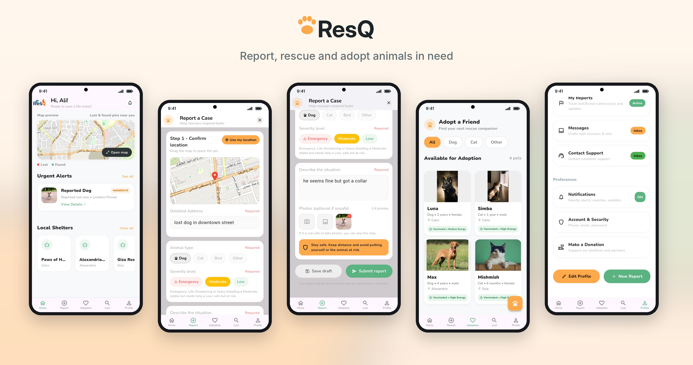
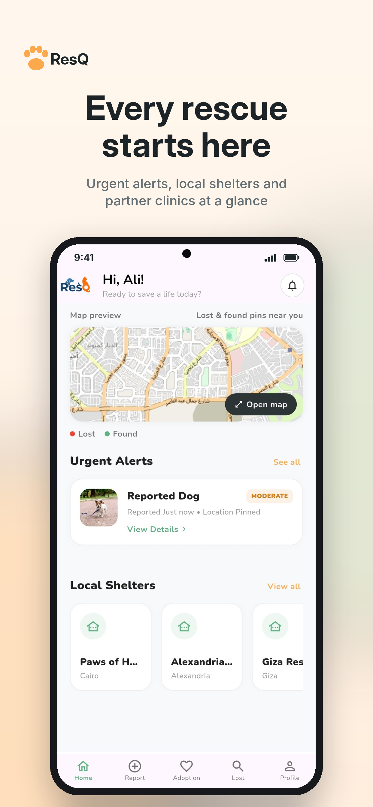
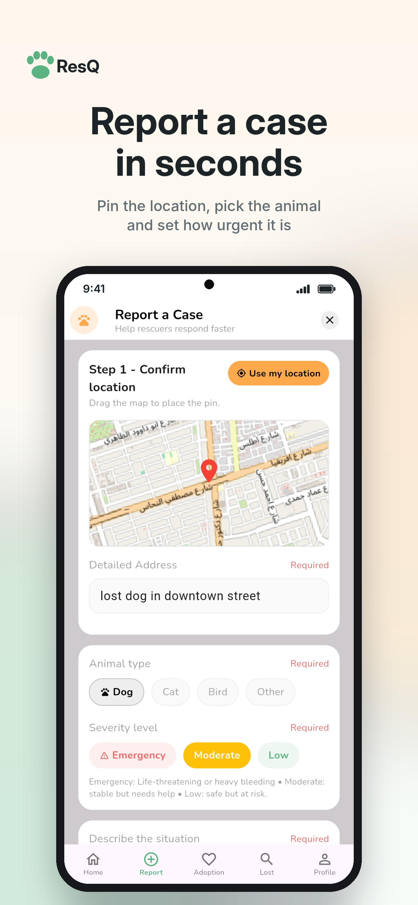
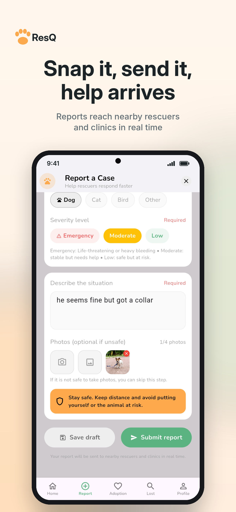
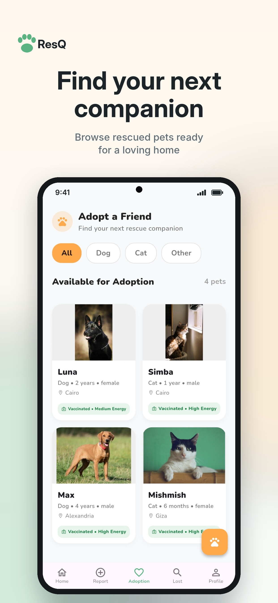
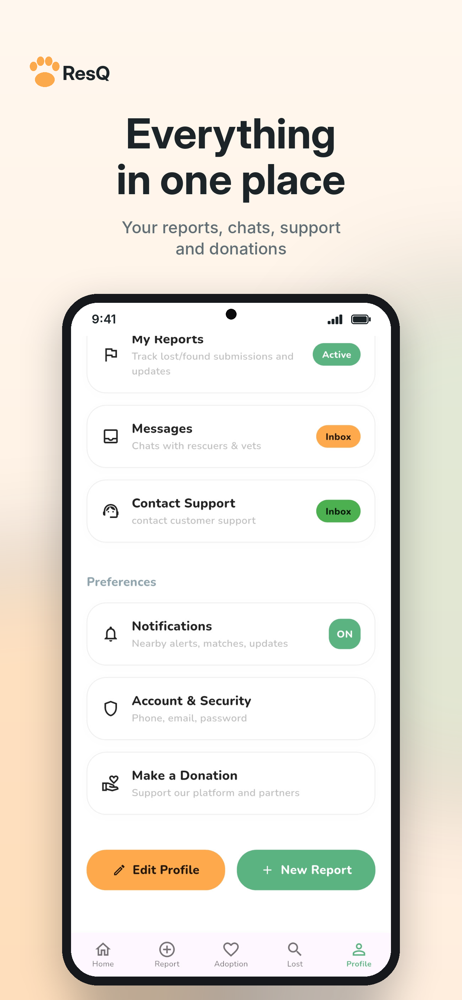

# ResQ



**Helping rescue animals from the streets by connecting the people who can save them.**

ResQ brings rescuers, volunteers, shelters, and veterinary clinics into one app, so
reporting an animal in need, getting it treated, and finding it a home is fast and organised.
Built as a university graduation project.

## ✨ Features

- **Report a case:** photo, location, and details of an animal that needs help
- **Shelters & clinics:** dedicated dashboards to receive cases, manage animals, and handle requests
- **Adoption:** browse animals and post them for adoption
- **Lost & found:** report and search for missing pets
- **Chat & support:** message shelters and clinics directly, plus in-app support
- **Donations:** pay through Stripe
- **Verified roles:** separate sign-up and identity verification for users, shelters, and clinics

## 📸 Screenshots

| | | |
|---|---|---|
|  |  |  |
|  |  | |

## 🛠️ Tech stack

| Layer | Tools |
|---|---|
| App | Flutter, Dart, GoRouter |
| Backend | Supabase: Postgres, Auth, Storage, Edge Functions |
| Maps & location | flutter_map, Geolocator |
| Payments | Stripe |

## 🚀 Running it locally

```bash
flutter pub get
flutter run
```

To run it against a local database, see [`LOCAL_DEMO.md`](LOCAL_DEMO.md). To self-host the backend, see [`selfhost/`](selfhost/).

## 👤 Author

**Ali Mahmoud** · [GitHub](https://github.com/asweddrtt) · [LinkedIn](https://www.linkedin.com/in/ali-mahmoud-26b89b22b/)

I built the app, its features, architecture, and integrations. Claude Code was used as a development assistant for refactoring and documentation.
